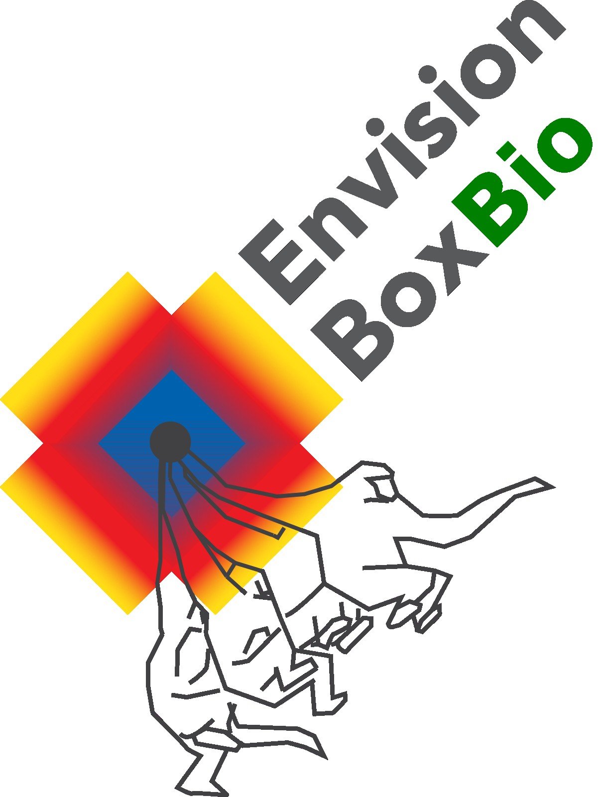

  
  
  

---

# Introduction

# Methods

## Data preprocessing

## Choice of models

## Weights and biases

# Results

# Discussion and impact

## Conclusion

# References
Yu, H., Xu, Y., Zhang, J., Zhao, W., Guan, Z., & Tao, D. (2021, August 28). _AP-10K: A Benchmark for Animal Pose Estimation in the Wild_. arXiv.org. <a href="https://arxiv.org/abs/2108.12617">https://arxiv.org/abs/2108.12617</a>